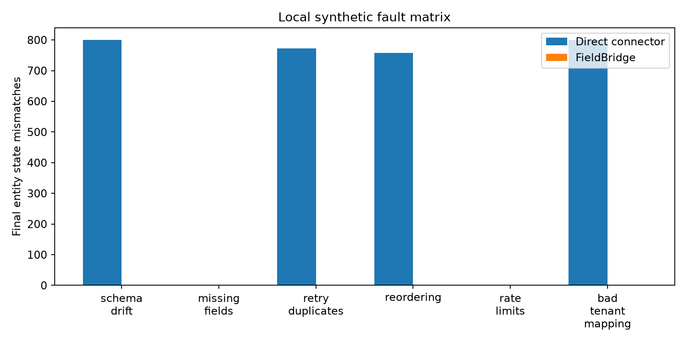
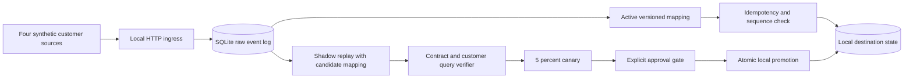
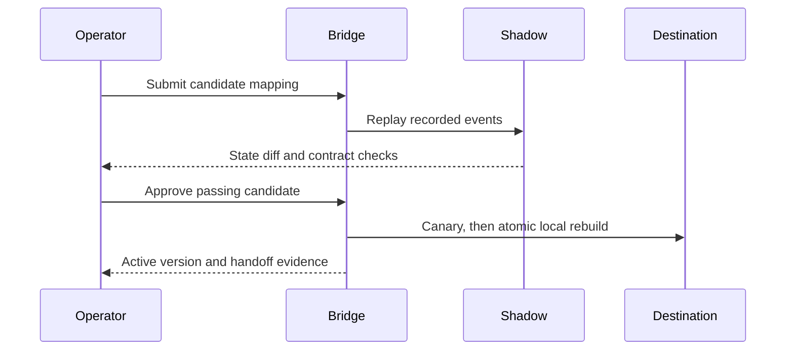
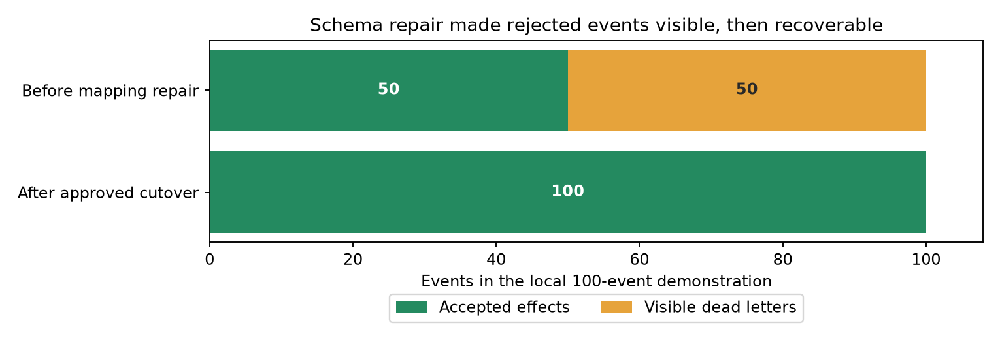

# FieldBridge: shadow-replayed customer integration cutover

## TL;DR

I built a local webhook integration that keeps the original events, tests a candidate field mapping in shadow mode, and requires a passing comparison plus approval before cutover. In the 11 November 2026 synthetic evaluation, **120 runs** across four customer profiles, six fault classes and five seeds processed **120,000 logical events / 122,860 deliveries**. After faults stopped, every valid event had one recorded effect, the final state matched an independently generated reference, and **20/20 wrong-tenant mapping candidates were rejected**. A deliberately simple direct connector had 3,130 final entity mismatches, 11,180 silently dropped delivery attempts, 2,860 duplicate effects and 20,000 wrong-tenant effects across the same matrix. These are results from my local simulator, not a customer deployment.



## What I built

- A localhost HTTP webhook receiver and four synthetic customer profiles covering invoices, inventory, seats and shipments. Each profile has v1 and renamed v2 payloads; [fixtures](fieldbridge/fixtures.py) generate the test events.
- A [SQLite integration core](fieldbridge/core.py) that keeps the raw delivery log, tenant-scoped event identities, versioned mappings, sequence-aware destination state and a visible dead-letter queue. Duplicate deliveries can be counted without applying a second effect.
- A candidate rollout path: shadow replay against the raw log, contract and customer-query checks, a 5% canary, explicit approval, and transactional local promotion or rollback.
- A read-only [LangGraph diagnostic assistant](fieldbridge/assistant.py) that can suggest a mapping but cannot approve or apply it. The [benchmark](fieldbridge/benchmark.py) compares destination state with a deliberately simple direct connector; the [CLI](fieldbridge/__main__.py) runs the demo and evaluation.

## One customer-style repair

The [Atlas example](docs/handoff_example.md) models an invoice integration whose provider renames `tenant`/`invoice_id`/`revision`/`amount_cents` to `org`/`invoice`/`rev`/`cents`. The old mapping still accepts the first 50 v1 events, then puts all 50 v2 events in a visible dead-letter queue. In the same 100-event scenario, the simple direct connector would silently drop those 50 deliveries and leave 28 invoice entities in the wrong final state.

| Question an integration owner would ask | What the demo checks |
| --- | --- |
| Were the missing invoices retained? | All 100 raw deliveries remain available for replay; 50 rejected v2 events are visible before repair. |
| Could a proposed mapping corrupt amounts? | A deliberately wrong `+1` value mapping fails 12 selected customer invoice queries before promotion. |
| What changed after cutover? | The v1+v2 mapping promotes after shadow checks and approval; 100 events have one accepted effect each, with no dead letters. |
| Can this be rolled back? | A failed local SQLite promotion rolls back atomically; an external API would need its own compensation plan. |

The [generated handoff](docs/handoff_example.md) records the failure, acceptance checks, change, rollback plan and residual risk. This is a synthetic stand-in for a customer engagement, with reproducible evidence for each step.

## Why I made this

A webhook endpoint can return success while a renamed field quietly drops business records. Retries and reordering make the repair harder: applying a new mapping directly can duplicate effects or corrupt the latest value. I wanted a repair path that showed the actual destination state before the change became active.

## Architecture



The four profiles stand for invoice amounts, inventory units, active seats and shipment progress. Each has a v1 contract and a renamed v2 contract. The raw log, destination effects and current mapping are durable in SQLite. A repeated event ID within the same tenant increments its delivery count but does not create another effect; the same external ID in a different tenant remains distinct. For an entity, a lower sequence number cannot overwrite a newer value. A local 429 is retried within a bounded budget; malformed or unsupported events remain visible in the dead-letter queue.



The optional [LangGraph diagnostic assistant](fieldbridge/assistant.py) reads counts and schema outcomes, proposes either keeping v1 or considering the declared v1+v2 mapping, and calls the same deterministic verifier. It cannot approve or write to the destination. The model is called once per diagnosis; event processing does not depend on it.

## Results

The reproducible workload is four profiles × six fault classes × five seeds, with 1,000 logical events per run. Faults are schema drift, missing required fields, duplicate deliveries, out-of-order delivery, transient 429s and a wrong-tenant candidate. The [saved results](results/evaluation.json) include each case, environment, command, seeds and load average.

| Measure across 120 runs | FieldBridge | Direct connector baseline |
| --- | ---: | ---: |
| Final entity state mismatches | 0 | 3,130 |
| Valid events left unapplied | 0 | Not tracked by baseline |
| Silent delivery drops | 0 | 11,180 |
| Duplicate destination effects | 0 | 2,860 |
| Wrong-tenant effects | 0 | 20,000 |
| Bad tenant mappings rejected before cutover | 20/20 | No gate |

The local HTTP [demo result](results/demo.json) starts with 50 accepted v1 events and 50 visible v2 dead letters. A bad value mapping fails twelve selected customer query checks. The approved v1+v2 mapping ends with 100 accepted effects and no dead letters. The direct connector baseline for this same case would silently drop 50 deliveries and leave 28 final invoice entities mismatched.



This second image is the single 100-event demo, not another sample from the 120-run benchmark. Both figures are generated from the saved JSON by [scripts/make_figures.py](scripts/make_figures.py).

In the separate [local-model demo](results/model_demo.json), the assistant chose the useful v1+v2 candidate, but its explanation incorrectly said v1 was dead-lettered; the actual counts show v2 was. This is why the assistant's prose is not used as cutover evidence.

**What these numbers do not show:** the benchmark uses synthetic customers and fault generators I wrote. The independent expected state is generated from the event specification, but the contract checks used at cutover are also synthetic. All twenty bad mapping candidates corrupt tenant routing in the same way; 20/20 is not a general detection rate for arbitrary bugs. The approval gate is a Boolean set by the local demo or operator; it does not authenticate or audit a real person. The destination is a local SQLite transaction, so rollback is atomic here; an external SaaS API would need staging or compensating writes. The baseline is intentionally simple and does not represent a tuned commercial connector. I do not claim production latency from these runs.

## Run it yourself

On an Apple silicon Mac with Python 3.11:

```bash
python3.11 -m venv .venv
.venv/bin/python -m pip install -r requirements.txt
.venv/bin/python -m pytest -q
.venv/bin/python -m fieldbridge demo
.venv/bin/python -m fieldbridge evaluate --events 1000 --seeds 5
.venv/bin/python scripts/make_figures.py
```

The test command should report **10 passed**. The demo writes [results/demo.json](results/demo.json): check `bad_candidate_rejected: true`, `good_candidate_promoted: true`, 100 accepted effects, zero final dead letters and `direct_connector_baseline.state_mismatches: 28`. The evaluation writes [results/evaluation.json](results/evaluation.json); rerunning it regenerates the 120-case matrix. `make_figures.py` rebuilds both images from those result files. The core demo and benchmark use no paid API. To include a real local model diagnosis, run `.venv/bin/python -m fieldbridge demo --model`; it downloads the quantized [Qwen2.5 1.5B MLX model](https://huggingface.co/mlx-community/Qwen2.5-1.5B-Instruct-4bit) on first use.

## Tests

```bash
.venv/bin/python -m pytest -q
```

The tests exercise a live localhost HTTP request, source identity rejection, schema drift repair, wrong-tenant rejection, duplicate and reordered deliveries, dead letters, 429 retries, approval, atomic rollback under an injected failure and the read-only diagnostic graph.

## What this isn't

It is not evidence of a real customer integration, stakeholder discovery, production deployment or exactly-once delivery to an arbitrary external API. The reversible promotion works because both the simulated destination and mapping live in one SQLite transaction. A real deployment would need a destination-specific cutover and compensation plan.

The source, test cases, handoff and saved measurements are included so the cutover can be inspected end to end.
